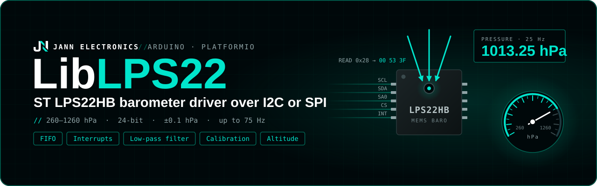

<p align="center">
  
</p>

# LibLPS22

Arduino library for the ST **LPS22HB** MEMS barometric pressure sensor: 260 to 1260 hPa absolute
pressure with 24-bit output (4096 LSB/hPa) and a temperature sensor, over **I2C** or **SPI**.

- One-shot (blocking or non-blocking) and continuous modes from 1 to 75 Hz.
- Pressure and temperature always read from the same conversion.
- Extra low-pass filter (ODR/9, ODR/20) and low-current mode.
- One-point offset calibration against a reference barometer.
- Reference pressure modes (AutoZero, AutoRifp) for relative measurements.
- Pressure threshold interrupts and full INT_DRDY pin configuration.
- 32-sample FIFO with all the chip's modes.
- Pressure in 8 units, altitude and sea-level pressure helpers.
- Errors reported as `false` / `NAN`, never as valid-looking values; every wait has a timeout.

## Contents

- [LibLPS22](#liblps22)
  - [Contents](#contents)
  - [Installation](#installation)
  - [Wiring](#wiring)
  - [Quick start](#quick-start)
    - [I2C](#i2c)
    - [SPI](#spi)
  - [How the library is organized](#how-the-library-is-organized)
    - [Error handling](#error-handling)
    - [Blocking calls](#blocking-calls)
  - [Data rates and reading](#data-rates-and-reading)
  - [Configuration](#configuration)
  - [Units and altitude](#units-and-altitude)
  - [Calibration](#calibration)
  - [Reference pressure](#reference-pressure)
  - [Threshold interrupts](#threshold-interrupts)
  - [INT\_DRDY pin](#int_drdy-pin)
  - [FIFO](#fifo)
  - [API reference](#api-reference)
  - [Examples](#examples)
  - [Notes and limitations](#notes-and-limitations)
  - [License](#license)

## Installation

With PlatformIO, add the repository to `lib_deps` in `platformio.ini`:

```ini
lib_deps =
  https://github.com/Jann-Electronics/LibLPS22.git
```

The library uses only the Arduino `Wire` and `SPI` libraries.

## Wiring

| Interface | CS pin    | Address / select                                         | Bus                     |
| --------- | --------- | -------------------------------------------------------- | ----------------------- |
| I2C       | To VDD_IO | `0x5C` (SA0 to GND, `ADDRESS_LOW`) or `0x5D` (SA0 to VDD_IO, `ADDRESS_HIGH`) | Up to 400 kHz |
| SPI       | To a GPIO | Chip select, active low                                  | 4-wire, mode 3, ≤ 10 MHz |

- Do not leave **SA0** floating on I2C: the address becomes undefined.
- **INT_DRDY** is optional. It carries data ready, FIFO flags or pressure threshold events.
- The bus must be initialized by the user (`Wire.begin()` / `SPI.begin()`) before `begin()`.

## Quick start

### I2C

```cpp
#include <Arduino.h>
#include <Wire.h>
#include "LPS22.h"

LPS22::Driver sensor(Wire, LPS22::ADDRESS_LOW);

void setup() {
  Serial.begin(115200);
  Wire.begin();

  if (!sensor.begin()) {
    Serial.println("LPS22HB not found");
    while (true)
      delay(1000);
  }
}

void loop() {
  LPS22::Measurement m;
  if (sensor.read(m)) // one-shot: triggers a conversion and waits for it
    Serial.printf("%.2f hPa  |  %.2f °C\n", m.pressure, m.temperature);

  delay(1000);
}
```

### SPI

```cpp
LPS22::Driver sensor(SPI, PIN_CS); // 1 MHz by default, up to 10 MHz

void setup() {
  SPI.begin(); // must be called before sensor.begin()
  sensor.begin();
}
```

Everything else is identical to I2C. On SPI the driver also disables the chip's I2C interface, so
SPI traffic is never decoded as I2C.

## How the library is organized

Everything lives in the `LPS22` namespace and is included with `#include "LPS22.h"`.

| Name                  | Purpose                                                                   |
| --------------------- | ------------------------------------------------------------------------- |
| `LPS22::Driver`       | The sensor, over I2C or SPI.                                              |
| `LPS22::Measurement`  | `float pressure` (hPa) and `float temperature` (°C) from one conversion.  |
| `LPS22::FifoStatus`   | `level` (unread samples), `watermark` and `overrun` flags.                |
| Free functions        | `convertPressure()`, `pressureToAltitude()`, `seaLevelPressure()`, `toString()`. |

Configuration setters can be called **before** `begin()`: the values are stored and `begin()`
applies them all at once. After `begin()`, every setter is applied to the chip immediately. Calling
`begin()` again resets the chip and re-applies the whole configuration, for example after it lost
power.

### Error handling

- Methods that talk to the sensor return `bool` (`false` on failure) or `NAN`.
- `read()` sets both fields to `NAN` when it fails: use them only when it returns `true`.
- `begin()` returns `false` if the chip does not answer or its `WHO_AM_I` is not `0xB1`.
- Setters that validate their argument (`setPressureOffset()`, `setPressureThreshold()`) return
  `false` and change nothing when it is out of range.

### Blocking calls

| Call                                         | Waits for                                                  |
| -------------------------------------------- | ---------------------------------------------------------- |
| `begin()`                                    | Software reset (timeout 10 ms).                            |
| `read()` and the `read*()` helpers, one-shot | The conversion (timeout 100 ms).                           |
| First read after `begin()` or a change, continuous | The first new sample (up to 2 periods + 50 ms; ~2 s at 1 Hz). |
| `calibrate()`                                | 8 conversions (8 sample periods in continuous mode).       |
| `setDataRate()`, `setLowPassFilter()`, `setLowCurrentMode()` | A one-shot conversion still running.       |

## Data rates and reading

| `DataRate`                       | Behaviour of `read()`                                                     |
| -------------------------------- | ------------------------------------------------------------------------- |
| `OneShot` (default)              | Triggers a conversion and waits for it. The chip sleeps between reads.    |
| `Hz1`, `Hz10`, `Hz25`, `Hz50`, `Hz75` | The chip converts continuously; returns the latest sample immediately. |

`read()` returns pressure and temperature from the **same** conversion. `readPressure()`,
`readTemperature()` and `readAltitude()` are shortcuts that each perform one `read()`; in one-shot
mode each of them triggers its own conversion.

Non-blocking reads, in one-shot mode:

```cpp
sensor.triggerOneShot();       // start a conversion and return
// ... do something else ...
if (sensor.dataReady()) {
  sensor.read(m);              // reads that conversion without starting another one
}
```

At continuous rates, `dataReady()` tells when a new sample has arrived since the last read.

## Configuration

| Setting               | Setter                  | Default        |
| --------------------- | ----------------------- | -------------- |
| Data rate             | `setDataRate()`         | `OneShot`      |
| Low-pass filter       | `setLowPassFilter()`    | `Off` (ODR/2)  |
| Low-current mode      | `setLowCurrentMode()`   | Off            |
| Pressure offset       | `setPressureOffset()`   | 0 hPa          |
| Reference mode        | `setReferenceMode()`    | `Absolute`     |
| Threshold events      | `setPressureEvents()`   | `None`         |
| Pressure threshold    | `setPressureThreshold()`| 0 hPa          |
| Latched interrupts    | `setInterruptLatched()` | Off            |
| INT_DRDY source       | `setPinSource()`        | `DataSignals`  |
| INT_DRDY data signals | `setDataSignals()`      | `None`         |
| INT_DRDY polarity     | `setPinPolarity()`      | `ActiveHigh`   |
| INT_DRDY drive        | `setPinDrive()`         | `PushPull`     |
| FIFO mode             | `setFifoMode()`         | `Bypass`       |
| FIFO watermark        | `setFifoWatermark()`    | 0, no stop     |

| `LowPassFilter` | Bandwidth | Notes                                         |
| --------------- | --------- | --------------------------------------------- |
| `Off`           | ODR/2     |                                               |
| `OdrDiv9`       | ODR/9     |                                               |
| `OdrDiv20`      | ODR/20    | Lowest noise. Only active at continuous rates. |

Low-current mode lowers the supply current from about 12 µA to 3 µA at 1 Hz, at the cost of more
noise.

## Units and altitude

All pressures are in **hPa** unless a unit is given. `readPressure(unit)` and
`convertPressure(hpa, unit)` support:

| `Unit`                    | Conversion          |
| ------------------------- | ------------------- |
| `Hectopascal`, `Millibar` | 1 hPa               |
| `Kilopascal`              | 0.1 kPa             |
| `Pascal`                  | 100 Pa              |
| `Psi`                     | 0.0145038 psi       |
| `Atmosphere`              | 1 / 1013.25 atm     |
| `MmHg`                    | 0.750062 mmHg       |
| `InHg`                    | 0.0295300 inHg      |

Altitude uses the international barometric formula:

```cpp
float altitude = LPS22::pressureToAltitude(pressure_hpa, sea_level_hpa); // meters
float qnh      = LPS22::seaLevelPressure(pressure_hpa, known_altitude_m); // hPa
float altitude = sensor.readAltitude(qnh);                               // reads and converts
```

With the default sea-level pressure (1013.25 hPa) the result is the standard-atmosphere altitude,
which can be off by tens of meters depending on the weather. For absolute altitude, pass the local
QNH or compute it once at a known altitude with `seaLevelPressure()`, as in the `altitude` example.

## Calibration

The LPS22HB is factory calibrated, but soldering can shift its offset. The chip can subtract a
one-point calibration (OPC) offset from every reading:

| Method                          | Description                                                            |
| ------------------------------- | ---------------------------------------------------------------------- |
| `calibrate(reference_hpa)`      | Averages 8 readings and sets the offset so they match `reference_hpa`. |
| `setPressureOffset(hpa)` / `getPressureOffset()` | Set or read the offset directly (±2048 hPa, 1/16 hPa steps). |

The offset register is **volatile**. Store the value from `getPressureOffset()` (in flash, NVS, ...)
and pass it to `setPressureOffset()` on every boot. `calibrate()` requires `ReferenceMode::Absolute`
and the FIFO in `Bypass` mode.

## Reference pressure

The chip can capture the current pressure as a **reference** (`REF_P`). The reference is captured
by the next conversion after the mode is selected; `captureReference()` captures a new one.

| `ReferenceMode`      | Readings                                    | Threshold interrupts compare         |
| -------------------- | ------------------------------------------- | ------------------------------------ |
| `Absolute` (default) | Absolute pressure                           | Not specified by the datasheet       |
| `AutoRifp`           | Absolute pressure                           | Pressure − reference                 |
| `AutoZero`           | Pressure − reference (can be negative)      | Pressure − reference                 |

`readReferencePressure()` returns the captured reference in hPa. `readAltitude()` returns `NAN` in
`AutoZero` mode, because readings are relative.

## Threshold interrupts

Events fire when the differential pressure (pressure − reference) goes above `+threshold` (`High`)
or below `−threshold` (`Low`). They need `AutoRifp` or `AutoZero`.

```cpp
sensor.setDataRate(LPS22::DataRate::Hz10);
sensor.setReferenceMode(LPS22::ReferenceMode::AutoRifp);
sensor.setPressureThreshold(0.5f);                         // hPa, 1/16 hPa steps
sensor.setPressureEvents(LPS22::PressureEvent::Both);
sensor.setInterruptLatched(true);
sensor.setPinSource(LPS22::PinSource::PressureHighOrLow);  // events on INT_DRDY

// In loop(), after the pin fires:
LPS22::PressureEvent event = sensor.readInterruptSource(); // also releases the latch
```

With latched interrupts, events stay in `INT_SOURCE` and on the pin until `readInterruptSource()` is
called. Without latching they follow the pressure.

## INT_DRDY pin

| Method                         | Description                                                                 |
| ------------------------------ | --------------------------------------------------------------------------- |
| `setPinSource(PinSource)`      | `DataSignals`, `PressureHigh`, `PressureLow` or `PressureHighOrLow`.        |
| `setDataSignals(DataSignal)`   | With `DataSignals`: `DataReady`, `FifoWatermark`, `FifoOverrun`, `FifoFull`, combined with `\|`. |
| `setPinPolarity(PinPolarity)`  | `ActiveHigh` or `ActiveLow`.                                                |
| `setPinDrive(PinDrive)`        | `PushPull` or `OpenDrain`.                                                  |

```cpp
sensor.setDataSignals(LPS22::DataSignal::DataReady | LPS22::DataSignal::FifoOverrun);
```

`LPS22::any()` and `LPS22::has()` test `DataSignal` and `PressureEvent` values.

## FIFO

The FIFO stores up to 32 samples (pressure and temperature), so the host can sleep and read them
in one go. While the FIFO is enabled, `read()` pops the oldest sample.

| `FifoMode`        | Behaviour                                                                 |
| ----------------- | ------------------------------------------------------------------------- |
| `Bypass`          | FIFO disabled (default).                                                  |
| `Fifo`            | Fills up and stops when full (or at the watermark, with stop-on-watermark). |
| `Stream`          | Keeps the newest 32 samples.                                              |
| `DynamicStream`   | Like `Stream`, but the level always counts only new samples.              |
| `StreamToFifo`    | `Stream` until a threshold interrupt, then `Fifo`.                        |
| `BypassToStream`  | `Bypass` until a threshold interrupt, then `Stream`.                      |
| `BypassToFifo`    | `Bypass` until a threshold interrupt, then `Fifo`.                        |

The last three switch on a threshold interrupt: configure one, with latched interrupts.

```cpp
sensor.setDataRate(LPS22::DataRate::Hz10);
sensor.setFifoMode(LPS22::FifoMode::DynamicStream);
sensor.setFifoWatermark(25);

LPS22::Measurement samples[32];
uint8_t n = sensor.readFifo(samples, 32); // oldest first
```

Selecting a mode (or calling `resetFifo()`) empties the FIFO. The datasheet recommends discarding
the first sample after switching into or out of a FIFO mode.

## API reference

| Method                                                    | Description                                                     |
| --------------------------------------------------------- | --------------------------------------------------------------- |
| `Driver(wire, address)`                                   | I2C constructor. Defaults: `Wire`, `ADDRESS_LOW` (`0x5C`).      |
| `Driver(spi, cs_pin, spi_freq_hz)`                        | SPI constructor. `spi_freq_hz` defaults to 1 MHz (clamped to 10 MHz). |
| `begin()`                                                 | Checks `WHO_AM_I`, resets the chip and applies the configuration. |
| `end()`                                                   | Puts the chip in power-down.                                    |
| `isInitialized()`                                         | `true` after a successful `begin()`.                            |
| `setDataRate()` / `getDataRate()`                         | `OneShot` or 1 to 75 Hz.                                        |
| `setLowPassFilter()` / `getLowPassFilter()`               | `Off`, `OdrDiv9` or `OdrDiv20`.                                 |
| `setLowCurrentMode()` / `isLowCurrentMode()`              | Low-current mode on/off.                                        |
| `setPressureOffset(hpa)` / `getPressureOffset()`          | One-point calibration offset.                                   |
| `calibrate(reference_hpa)`                                | Sets the offset from a reference pressure.                      |
| `setReferenceMode()` / `getReferenceMode()`               | `Absolute`, `AutoRifp` or `AutoZero`.                           |
| `captureReference()`                                      | Captures a new reference with the next conversion.              |
| `readReferencePressure()`                                 | Stored reference in hPa.                                        |
| `setPressureThreshold(hpa)` / `getPressureThreshold()`    | Threshold for interrupt events (0 to 4095.9375 hPa).            |
| `setPressureEvents()` / `getPressureEvents()`             | `None`, `High`, `Low` or `Both`.                                |
| `setInterruptLatched()` / `isInterruptLatched()`          | Latched interrupt requests.                                     |
| `readInterruptSource()`                                   | Events that occurred; releases latched events.                  |
| `setPinSource()`, `setDataSignals()`, `setPinPolarity()`, `setPinDrive()` | INT_DRDY pin configuration (with getters).       |
| `setFifoMode()` / `getFifoMode()`                         | FIFO mode; empties the FIFO.                                    |
| `setFifoWatermark(level, stop)` / `getFifoWatermark()` / `isFifoStopOnWatermark()` | Watermark (0 to 31) and stop-on-watermark. |
| `resetFifo()`                                             | Empties the FIFO and restarts the current mode.                 |
| `readFifoStatus()`                                        | Level, watermark and overrun flags.                             |
| `readFifo(buffer, max_samples)`                           | Reads samples, oldest first. Returns how many were read.        |
| `read(Measurement&)`                                      | Pressure and temperature from one conversion.                   |
| `readPressure(unit)`                                      | Pressure in the given unit (hPa by default).                    |
| `readTemperature()`                                       | Temperature in °C.                                              |
| `readAltitude(sea_level_hpa)`                             | Altitude in meters.                                             |
| `triggerOneShot()`                                        | Starts a one-shot conversion without waiting.                   |
| `dataReady()`                                             | `true` when a new sample is available.                          |

## Examples

| Example                                            | Shows                                                         |
| -------------------------------------------------- | ------------------------------------------------------------- |
| [basic](examples/basic/basic.cpp)                  | One-shot readings over I2C, pressure in hPa and psi.          |
| [continuous](examples/continuous/continuous.cpp)   | 25 Hz with the ODR/20 filter, non-blocking reads with `dataReady()`. |
| [altitude](examples/altitude/altitude.cpp)         | Offset calibration, sea-level pressure and altitude.          |
| [interrupt](examples/interrupt/interrupt.cpp)      | Pressure change events on INT_DRDY with `AutoRifp`.           |
| [fifo](examples/fifo/fifo.cpp)                     | Dynamic-Stream FIFO read in batches on the watermark interrupt. |

The examples are written for an ESP32-S3; adjust the pin numbers for your board. Each one has its
own environment in [platformio.ini](platformio.ini): build one with `pio run -e <example>`.

## Notes and limitations

- Only the **LPS22HB** is supported (`WHO_AM_I = 0xB1`). The LPS22HH and LPS22DF have a different
  register map and are rejected by `begin()`.
- The datasheet forbids block data update (BDU) together with multi-byte reads on I2C. Outside FIFO
  modes the driver therefore enables BDU and reads the output registers one byte at a time, so a
  sample is never mixed with the next one. With the FIFO enabled it reads each sample in a single
  5-byte burst, which fits any `Wire` buffer.
- Every register the driver configures is volatile, including the calibration offset: `begin()`
  writes them all again.
- Methods are not thread safe and must not be called from an interrupt handler: set a flag in the
  handler and read the sensor in `loop()`, as in the `interrupt` and `fifo` examples.

## License

Released under the [MIT License](LICENSE).
